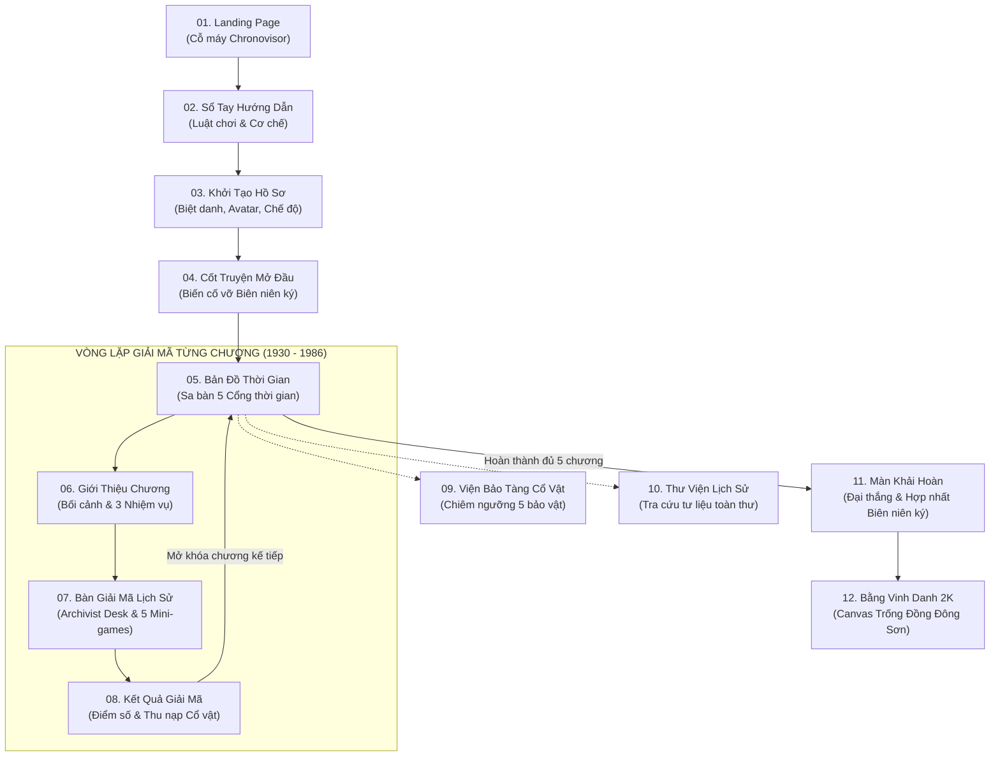

<div align="center">

# ⏳ MẬT MÃ THỜI GIAN — THE HIDDEN HISTORY
### *Giải mã quá khứ – Thấu hiểu lịch sử – Kết nối hiện tại*

Đồ án Website Game Tương Tác Khám Phá Lịch Sử & Giải Mã Bí Ẩn  
Dành riêng cho môn học **VNR202 – Lịch sử Đảng Cộng sản Việt Nam · Đại học FPT**

---

[](https://fpt.edu.vn)
[](https://react.dev/)
[](https://www.typescriptlang.org/)
[](https://vitejs.dev/)
[](https://tailwindcss.com/)
[](https://www.framer.com/motion/)
[](https://developer.mozilla.org/en-US/docs/Web/API/Window/localStorage)
[](scripts/test.mjs)
[](LICENSE)

[📖 Giới Thiệu](#-giới-thiệu-dự-án) •
[🗺️ 5 Mốc Son](#-5-chương-lịch-sử-hào-hùng) •
[🧩 5 Cơ Chế Mini-Game](#-5-cơ-chế-giải-mã-tương-tác) •
[🖥️ 12 Màn Hình](#-sơ-đồ-kiến-trúc-12-màn-hình) •
[⚡ Bắt Đầu Nhanh](#-hướng-dẫn-cài-đặt--chạy-cục-bộ) •
[🧪 Kiểm Thử](#-kiểm-thử--đảm-bảo-chất-lượng) •
[🏛️ Đạo Đức Học Thuật](#-quy-chuẩn-học-thuật--bản-quyền)

---

</div>

## 📖 Giới Thiệu Dự Án

**MẬT MÃ THỜI GIAN (The Hidden History)** là một sản phẩm game giáo dục nhập vai tương tác (*Story-driven Educational Mystery Game*). Người chơi vào vai một **Đặc Phái Viên** của Viện Lưu Trữ Thời Gian vào năm 2026, nhận sứ mệnh khôi phục cuốn **"Đại Việt Biên Niên Ký Thời Đại Mới"** bị đứt gãy thành 5 mảnh ký ức.

Bằng cách đi ngược dòng lịch sử về 5 mốc son chói lọi (1930, 1945, 1954, 1975, 1986), người chơi trực tiếp khảo cứu các văn kiện Đảng, bản thảo Tuyên ngôn, bức điện mật của Đại tướng, tác chiến trên sa bàn quân sự và đóng mộc thẩm định sự thật lịch sử.

### 🌟 Triết Lý Thiết Kế (The Archivist's Aesthetic)
- **Cổ điển & Học thuật:** Tone màu Đêm Sâu (`#0A1020`), Vàng Hoàng Kim (`#D6A75C`), Giấy Dó Cổ (`#F4EBD9`) và Đỏ Mộc Lưu Trữ (`#8D3038`).
- **Tư liệu thật:** Mỗi nhiệm vụ đi kèm một trích đoạn tư liệu lịch sử có trích dẫn nguồn sách/văn kiện chính thống.
- **Tiện lợi tuyệt đối:** Không cần tạo tài khoản, không cần cơ sở dữ liệu (Zero Backend), lưu trữ tiến độ tự động trên trình duyệt.

---

## 🗺️ 5 Chương Lịch Sử Hào Hùng

Hệ thống bao gồm **5 chương lịch sử** với **15 hồ sơ giải mã chuyên sâu**:

| Chương | Năm | Tên Khúc Quanh | Sự Kiện Lịch Sử Cốt Lõi | Mảnh Ký Ức Thu Thập |
| :---: | :---: | :--- | :--- | :---: |
| **01** | **1930** | **Khởi Nguồn** | Hội nghị hợp nhất tại Hồng Kông & Sự ra đời của Đảng Cộng sản Việt Nam | 🔑 *Ấn Vàng Khởi Nguồn* |
| **02** | **1945** | **Mùa Thu Độc Lập** | Cách mạng Tháng Tám & Bản Tuyên ngôn Độc lập khai sinh nước VNDCCH | 📜 *Bản Thảo Độc Lập* |
| **03** | **1954** | **Đường Đến Điện Biên** | Chiến thắng Điện Biên Phủ "lừng lẫy năm châu, chấn động địa cầu" | 🚩 *Ngọn Cờ Quyết Thắng* |
| **04** | **1975** | **Thống Nhất** | Đại thắng Mùa Xuân 1975 – Non sông thu về một mối sau 21 năm chia cắt | ⭐ *Ngôi Sao Thống Nhất* |
| **05** | **1986** | **Bước Ngoặt Đổi Mới** | Đại hội VI – Đường lối Đổi Mới toàn diện đưa đất nước vươn tầm thời đại | ⚙️ *Bánh Răng Đổi Mới* |

---

## 🧩 5 Cơ Chế Giải Mã Tương Tác

Mỗi nhiệm vụ trong phòng giải mã sử dụng một trong 5 cơ chế trò chơi tương tác riêng biệt:

```
┌────────────────────────────────────────────────────────────────────────┐
│                   5 CƠ CHẾ MINI-GAME LỊCH SỬ                           │
├─────────────────────┬──────────────────────────────────────────────────┤
│ 1. Timeline Order   │ Sắp xếp thẻ sự kiện theo trình tự số La Mã (↑/↓) │
│ 2. Dossier Match    │ Ghép nối nhân vật/tư liệu với sự kiện lịch sử    │
│ 3. Truth or Myth    │ Thẩm định mộc đỏ cổ điển: CHÍNH SỬ vs NGỤY THUYẾT│
│ 4. Detective Clues  │ Kính lúp soi tư liệu gốc & giải mã mật tự        │
│ 5. Campaign Map     │ Sa bàn tác chiến 4x4, ghim cờ và điều động quân sự│
└─────────────────────┴──────────────────────────────────────────────────┘
```

- **Điều khiển đa nền tảng:** Hỗ trợ chuột kéo thả, chạm (touch) trên điện thoại và phím bấm trợ năng (Accessibility Keyboard).
- **Hệ thống chấm điểm công bằng:** 
  - +100 điểm cho mỗi nhiệm vụ giải đúng.
  - Sử dụng gợi ý: trừ 10 điểm/mức (tối đa 2 mức).
  - Chế độ Thử Thách: giới hạn 180s/nhiệm vụ, thưởng +5 điểm cho mỗi 10 giây còn lại.
  - Chơi lại (Replay) cập nhật điểm tốt nhất từng chương, không cho phép gian lận cộng dồn điểm.

---

## 🖥️ Sơ Đồ Kiến Trúc 12 Màn Hình

Hệ thống được tổ chức khoa học qua 12 màn hình trải nghiệm xuyên suốt:



---

## ⚡ Tính Năng Kỹ Thuật Nổi Bật

### 1. Kiến Trúc Không Cơ Sở Dữ Liệu (Zero-Backend)
- Toàn bộ dữ liệu tiến độ, điểm số, lịch sử giải đố và huy hiệu lưu trữ độc lập trên **HTML5 `LocalStorage`**.
- Trạng thái phiên làm việc (nhiệm vụ đang giải, gợi ý đã mở, đồng hồ đếm ngược) lưu trên **`SessionStorage`**, đảm bảo khi tải lại trang không bị mất trạng thái.
- Tuyệt đối bảo mật riêng tư: Không thu thập email, mật khẩu hay thông tin cá nhân của sinh viên.

### 2. Âm Thanh Tổng Hợp Thuần Thuật Toán (Web Audio API)
- Tích hợp bộ tạo âm thanh procedural synthesis bằng **Web Audio API**: tiếng tích tắc kim đồng hồ, tiếng gõ phím máy chữ, tiếng lật giấy dó, âm sắc giải mã thành công và tiếng đóng dấu mộc đỏ.
- Hoàn toàn độc lập, không phụ thuộc vào việc tải file MP3/WAV bên ngoài, tránh lỗi 404 và CORS khi triển khai.

### 3. Trợ Lý Lịch Sử AI (Gemini Serverless Proxy)
- Hỗ trợ giải thích và khai mở kiến thức lịch sử qua **Google Gemini API** (`api/history-guide.mjs`).
- Triển khai dạng Vercel Serverless Function: Giữ kín `GEMINI_API_KEY` ở môi trường server, không rò rỉ lên client bundle.
- **Cơ chế Fallback thông minh:** Khi không có mạng hoặc không cấu hình API Key, hệ thống tự động hiển thị dữ liệu lịch sử đã biên soạn sẵn mà không làm gián đoạn trải nghiệm người dùng.

### 4. Xuất Bằng Chứng Nhận Danh Dự 2K (Canvas Engine)
- Render trực tiếp Bằng Chứng Nhận độ phân giải cao **1920×1080 (Chuẩn in ấn sắc nét)** bằng HTML5 Canvas.
- Họa tiết viền **Trống đồng Đông Sơn**, ngôi sao lịch sử, con dấu mộc đỏ kiểm định, khắc tên riêng của sinh viên, mã định danh duy nhất (UUID) và ngày cấp.

---

## 📂 Cấu Trúc Thư Mục Dự Án

```
THE-HIDDEN-HISTORY/
├── api/
│   └── history-guide.mjs         # Serverless function proxy cho Google Gemini AI
├── docs/
│   └── implementation_plan_vnr202.md # Đặc tả kỹ thuật & kế hoạch dự án 6 Sprint
├── public/                       # Static assets, favicon, PWA icons, manifest
├── scripts/
│   ├── api.test.mjs              # Test suite kiểm thử 6 kịch bản Serverless API
│   ├── game.test.ts              # Test suite kiểm thử 40 kịch bản logic game
│   └── test.mjs                  # Runner chạy toàn bộ unit tests độc lập
├── src/
│   ├── assets/                   # Vector assets, Dong Son patterns, logo
│   ├── components/
│   │   ├── common/               # ParticleBackground, NarrationButton, AudioController
│   │   ├── game/                 # Puzzle.tsx (5 mini-games engine), ClueCard, Dossier
│   │   └── layout/               # Header.tsx (Live HUD, Rank), Footer.tsx
│   ├── context/
│   │   ├── AudioContext.tsx      # Quản lý hiệu ứng âm thanh Web Audio
│   │   └── GameContext.tsx       # State machine: tiến độ, điểm số, LocalStorage sync
│   ├── data/
│   │   └── chapters/             # 5 file JSON dữ liệu tư liệu lịch sử chương 1 - 5
│   ├── pages/                    # 12 màn hình từ 01_LandingPage đến 12_CertificatePage
│   ├── services/
│   │   ├── aiService.ts          # Client gọi API Cố vấn lịch sử
│   │   ├── audioService.ts       # Synthesizer phát âm thanh lịch sử
│   │   └── certificateService.ts # Canvas engine vẽ Bằng khen Trống đồng 1920x1080
│   ├── types/                    # TypeScript interfaces & game models
│   ├── utils/                    # LocalStorage handlers, scoring, formatting
│   ├── App.tsx                   # Bộ định tuyến React Router & Shell layout
│   ├── index.css                 # Hệ thống màu sắc Heritage, Giấy dó, Mộc đỏ
│   └── main.tsx                  # Điểm khởi động ứng dụng
├── tests/
│   └── mobile-layout.spec.ts     # Playwright e2e kiểm thử 24 viewport mobile (320px/375px)
├── playwright.config.ts          # Cấu hình Playwright kiểm thử giao diện
├── vercel.json                   # Cấu hình định tuyến SPA & API Vercel
├── vite.config.ts                # Cấu hình Vite & Tailwind v4 & Vite PWA
└── package.json                  # Định nghĩa dependencies & npm scripts
```

---

## 🚀 Hướng Dẫn Cài Đặt & Chạy Cục Bộ

### 1. Yêu cầu môi trường
- **Node.js:** Phiên bản `22.12.0+` hoặc `24.x`.
- **Package Manager:** `npm` (đi kèm Node.js).

### 2. Cài đặt các gói phụ thuộc
```bash
# Clone repository
git clone https://github.com/your-username/the-hidden-history.git
cd the-hidden-history

# Cài đặt chính xác các package theo lockfile
npm ci
```

### 3. Khởi động môi trường phát triển (Development)
```bash
npm run dev
```
> Truy cập ứng dụng tại: `http://localhost:5173`

### 4. Xây dựng bản phát hành (Production Build)
```bash
# Kiểm tra kiểu dữ liệu TypeScript & đóng gói Vite
npm run build

# Xem thử bản build production
npm run preview
```

---

## 🧪 Kiểm Thử & Đảm Bảo Chất Lượng

Dự án áp dụng quy trình kiểm thử nghiêm ngặt đa tầng:

```bash
# 1. Chạy 46 bài kiểm thử Logic Game & API Serverless
npm test

# 2. Kiểm thử hiển thị Responsive Mobile (Playwright - 24 viewports)
npm run test:layout

# 3. Kiểm tra cú pháp nhanh (Linter)
npm run lint
```

### Kết quả kiểm thử chuẩn:
- ✅ **40/40 Logic checks passed:** Kiểm tra toàn diện 15 câu đố, quy tắc phạt điểm gợi ý, cơ chế khóa chương, chống gian lận nộp trùng, canvas xuất chứng nhận và storage.
- ✅ **6/6 API checks passed:** Kiểm tra method `POST`, xác thực câu hỏi đầu vào, cơ chế timeout và xử lý lỗi upstream Gemini.
- ✅ **24/24 Layout checks passed:** Đảm bảo không bị tràn ngang (horizontal overflow), không bị cắt chữ và nút bấm tối thiểu 40px trên màn hình nhỏ (320px – 375px).

---

## 🌐 Hướng Dẫn Triển Khai (Deployment)

### Triển khai trên Vercel (Khuyến nghị)
1. Kết nối repository GitHub với Vercel.
2. Vercel tự động nhận diện cấu hình trong `vercel.json` và thiết lập Framework: **Vite**.
3. (Tùy chọn AI Guide): Trong mục **Project Settings $\rightarrow$ Environment Variables**, thêm:
   - `GEMINI_API_KEY`: Khóa API từ [Google AI Studio](https://aistudio.google.com/).
   - `GEMINI_MODEL`: `gemini-1.5-flash` hoặc model bạn có quyền sử dụng.
4. Nhấn **Deploy**.

### Triển khai Static Hosting (GitHub Pages / Cloudflare Pages / Netlify)
Chạy lệnh `npm run build` và tải thư mục `dist/` lên dịch vụ hosting. Lưu ý cấu hình chuyển hướng mọi route (Rewrite) về `index.html`. Trong trường hợp này, ứng dụng sẽ sử dụng kho tư liệu tĩnh biên soạn sẵn cho Trợ lý lịch sử.

---

## 🏛️ Quy Chuẩn Học Thuật & Bản Quyền

- **Môn học:** VNR202 – Lịch sử Đảng Cộng sản Việt Nam.
- **Đơn vị bảo trợ:** Đại học FPT (FPT University).
- **Tính xác thực tư liệu:** Mọi mốc sự kiện, văn kiện, trích dẫn nhật lệnh và số liệu đều được biên soạn bám sát theo *Giáo trình Lịch sử Đảng Cộng sản Việt Nam* (Nhà xuất bản Chính trị Quốc gia Sự thật).
- **Lưu ý pháp lý:** Bằng Chứng Nhận Vinh Danh được cấp từ trang web là phần thưởng tượng trưng ghi nhận nỗ lực hoàn thành trò chơi, không thay thế bảng điểm hay chứng chỉ tín chỉ chính thức của Đại học FPT.

---

<div align="center">

**MẬT MÃ THỜI GIAN — THE HIDDEN HISTORY**  
*Được phát triển với niềm tự hào và lòng biết ơn sâu sắc đối với lịch sử dân tộc Việt Nam.*

[](https://github.com)

</div>
