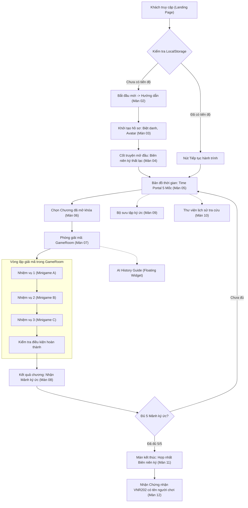
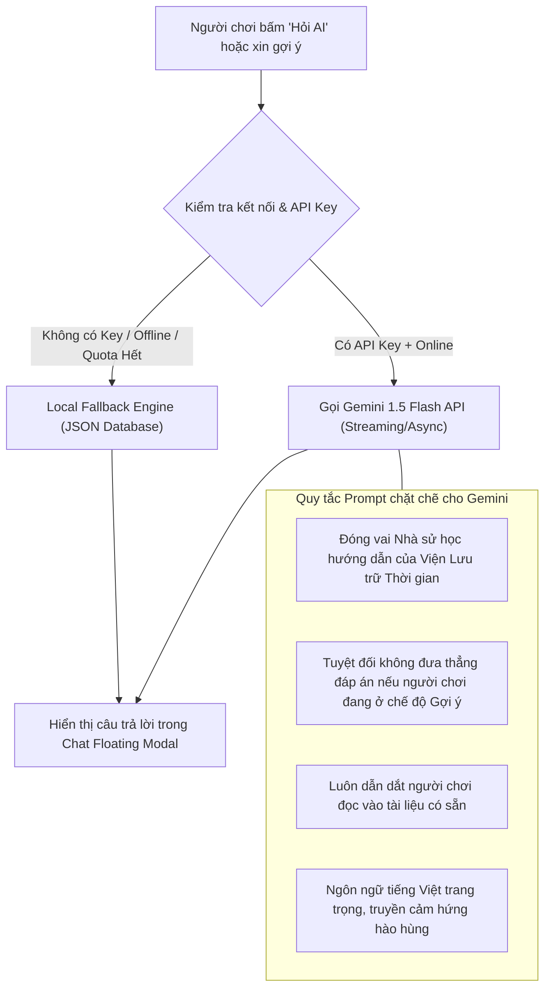

# MASTER IMPLEMENTATION PLAN
## DỰ ÁN: WEBSITE GAME TƯƠNG TÁC LỊCH SỬ VNR202 – MẬT MÃ THỜI GIAN (THE HIDDEN HISTORY)
*Dành cho môn học VNR202 – Lịch sử Đảng Cộng sản Việt Nam (Đại học FPT)*

---

### Mục lục tài liệu
1. [Tổng quan dự án & Tiêu chuẩn kỹ thuật](#1-tổng-quan-dự-án--tiêu-chuẩn-kỹ-thuật)
2. [Kiến trúc hệ thống & Thiết kế luồng dữ liệu (State Flow)](#2-kiến-trúc-hệ-thống--thiết-kế-luồng-dữ-liệu-state-flow)
3. [Đặc tả cấu trúc dữ liệu JSON & Type System](#3-đặc-tả-cấu-trúc-dữ-liệu-json--type-system)
4. [Kiến trúc Game Engine & 5 Cơ chế Minigame linh hoạt](#4-kiến-trúc-game-engine--5-cơ-chế-minigame-linh-hoạt)
5. [Đặc tả chi tiết 12 Màn hình giao diện](#5-đặc-tả-chi-tiết-12-màn-hình-giao-diện)
6. [Đặc tả mô-đun AI History Guide (Hybrid Architecture)](#6-đặc-tả-mô-đun-ai-history-guide-hybrid-architecture)
7. [Hệ thống Âm thanh, Hiệu ứng hình ảnh & Certificate Engine](#7-hệ-thống-âm-thanh-hiệu-ứng-hình-ảnh--certificate-engine)
8. [Cấu trúc thư mục mã nguồn chuẩn hóa (Project Structure)](#8-cấu-trúc-thư-mục-mã-nguồn-chuẩn-hóa-project-structure)
9. [Lộ trình triển khai 6 Sprint & Kế hoạch kiểm thử](#9-lộ-trình-triển-khai-6-sprint--kế-hoạch-kiểm-thử)

---

## 1. Tổng quan dự án & Tiêu chuẩn kỹ thuật

### 1.1. Tuyên ngôn sản phẩm
- **Tên chính thức:** MẬT MÃ THỜI GIAN – THE HIDDEN HISTORY
- **Slogan:** *Giải mã quá khứ – Thấu hiểu lịch sử – Kết nối hiện tại.*
- **Đơn vị / Môn học:** VNR202 (Lịch sử Đảng Cộng sản Việt Nam) – Trường Đại học FPT.
- **Mục tiêu cốt lõi:** Biến những trang sử khô khan thành một cuộc phiêu lưu trinh thám lịch sử tương tác đỉnh cao (Story-driven Educational Mystery Game), giúp sinh viên FPT dễ dàng tiếp thu 5 mốc son chói lọi (1930 – 1945 – 1954 – 1975 – 1986) thông qua việc giải mã tư liệu, suy luận và nhận chứng chỉ hoàn thành xuất sắc.

### 1.2. Tech Stack quyết định
| Hạng mục | Công nghệ được chọn | Lý do lựa chọn |
| :--- | :--- | :--- |
| **Core Framework** | **React 18/19 + TypeScript + Vite** | Khởi động siêu tốc, gõ kiểu an toàn, tối ưu component re-usability cho 12 màn hình |
| **Styling & Theme** | **Tailwind CSS + Tailwind Animate** | Dễ dàng tùy biến theme mầu cổ kính (Gold, Dark Night, Papyrus), hỗ trợ responsive hoàn hảo |
| **Animation & VFX** | **Framer Motion + Canvas Confetti** | Hiệu ứng lật sách 3D, mở cổng thời gian, hiệu ứng hào quang cổ vật điện ảnh |
| **Icons & Visuals** | **Lucide-react** | Bộ icon phong phú, tối giản, thanh lịch phù hợp phong cách Mystery |
| **Storage Engine** | **HTML5 LocalStorage + JSON** | Không cần backend database, tự động đồng bộ điểm số, lưu tiến độ, chơi offline mượt mà |
| **Audio Engine** | **Web Audio API / Howler.js** | Hiệu ứng tiếng tích tắc đồng hồ, lật sách, gõ morse, nhạc nền hào hùng |
| **Certificate Gen** | **HTML Canvas / html2canvas** | Kết xuất giấy chứng nhận độ phân giải cao (High-res PNG) mang tên sinh viên |
| **AI Guide Engine** | **Google Gemini Flash API + Local Fallback** | AI trực tuyến trả lời thông minh + Bộ cơ sở dữ liệu gợi ý Offline độc lập |

---

## 2. Kiến trúc hệ thống & Thiết kế luồng dữ liệu (State Flow)

Toàn bộ ứng dụng vận hành theo mô hình **Unidirectional Data Flow** (Luồng dữ liệu một chiều) được quản lý tập trung qua `GameContext` và đồng bộ tức thời vào `LocalStorage`.



---

## 3. Đặc tả cấu trúc dữ liệu JSON & Type System

Hệ thống tách biệt triệt để **Logic giao diện** và **Nội dung lịch sử**. Tất cả 5 chương, 15 nhiệm vụ được định nghĩa dưới dạng JSON chuẩn.

### 3.1. TypeScript Definitions (`src/types/game.ts`)

```typescript
export type GameMode = 'exploration' | 'challenge'; // Thử thách có đếm giờ

export interface PlayerProfile {
  nickname: string;
  avatarId: string;
  gameMode: GameMode;
  createdAt: string;
}

export interface TaskOption {
  id: string;
  text: string;
  isCorrect?: boolean;
  matchTargetId?: string; // Dùng cho loại ghép nối
  orderIndex?: number;    // Dùng cho loại sắp xếp dòng thời gian
}

export type TaskType = 
  | 'timeline-order'      // Kéo thả/chạm sắp xếp niên đại
  | 'dossier-match'      // Nối sự kiện - ý nghĩa - tài liệu
  | 'document-detective' // Soi ảnh tư liệu, trích xuất dữ kiện
  | 'campaign-map'       // Định vị chiến dịch trên sa bàn/bản đồ
  | 'truth-or-myth';     // Phân tích nhận định đúng/sai

export interface TaskData {
  id: string;
  title: string;
  taskType: TaskType;
  instructions: string;
  historicalDocument: {
    title: string;
    excerpt: string;
    imageUrl?: string;
    sourceCitation: string; // Nguồn trích dẫn sách VNR202 FPT
  };
  question: string;
  options: TaskOption[];
  correctAnswerSummary: string; // Giải thích chi tiết sau khi trả lời
  points: number;
  aiHints: {
    level1: string; // Gợi ý nhẹ
    level2: string; // Gợi ý sâu hơn
    contextExploration: string; // Tư liệu mở rộng
  };
}

export interface ChapterData {
  id: number;
  year: number; // 1930, 1945, 1954, 1975, 1986
  codeName: string;
  title: string;
  slogan: string;
  historicalContext: string;
  coverImage: string;
  memoryFragment: {
    id: string;
    name: string;
    icon: string;
    description: string;
    historicalSignificance: string;
  };
  tasks: TaskData[];
}

export interface PlayerProgress {
  profile: PlayerProfile | null;
  currentChapterId: number;
  unlockedChapters: number[]; // e.g. [1, 2]
  completedChapters: number[]; // e.g. [1]
  collectedFragments: string[];
  chapterScores: Record<number, number>;
  totalScore: number;
  hintsUsedCount: number;
  isCompletedAll: boolean;
  certificateIssuedDate?: string;
}
```

---

## 4. Kiến trúc Game Engine & 5 Cơ chế Minigame linh hoạt

Thay vì viết mã giao diện riêng lẻ cho 15 nhiệm vụ, ta xây dựng **1 Game Engine dùng chung (`GameRoomPage`)** và **5 Minigame Component cắm ghép (Plug-and-play)**:

| Stt | Tên Minigame Component | Mô tả cơ chế tương tác | Ứng dụng trong 5 Chương |
| :---: | :--- | :--- | :--- |
| **01** | `TimelineOrderGame` | Cho phép người chơi kéo-thả (drag-and-drop) hoặc nhấn số thứ tự để sắp xếp 4-5 sự kiện theo đúng tiến trình thời gian. Hỗ trợ chạm trên điện thoại. | **Chương 2 (1945):** Khởi nghĩa từng phần -> Tổng khởi nghĩa -> 2/9.<br>**Chương 4 (1975):** Tây Nguyên -> Huế-Đà Nẵng -> Chiến dịch Hồ Chí Minh. |
| **02** | `DossierMatchGame` | Cơ chế "Lật hồ sơ bí mật" & ghép đôi: Nối cột bên trái (Văn kiện, Chỉ thị, Tên lãnh đạo) với cột bên phải (Nội dung, Ý nghĩa lịch sử). | **Chương 1 (1930):** Ghép Cương lĩnh chính trị đầu tiên.<br>**Chương 3 (1954):** Nối 3 đợt tiến công Điện Biên Phủ với cứ điểm then chốt. |
| **03** | `DocumentDetectiveGame` | Kính lúp soi chiếu tài liệu: Hiển thị bản chụp tư liệu lịch sử (Tờ báo Độc Lập, Lời kêu gọi toàn quốc kháng chiến, ảnh tư liệu). Người chơi click các điểm nóng (Hotspots) để tìm manh mối trả lời. | **Chương 2 (1945):** Phân tích bức ảnh Lễ Tuyên ngôn Độc lập tại Ba Đình.<br>**Chương 4 (1975):** Đọc bức điện mật "Thần tốc, thần tốc hơn nữa" của Đại tướng Võ Nguyên Giáp. |
| **04** | `CampaignMapGame` | Sa bàn chiến dịch tương tác: Bản đồ hiển thị các vị trí chiến lược, người chơi kéo ghim cờ hoặc chọn tọa độ đột phá của quân ta. | **Chương 3 (1954):** Đồi A1, C1, Him Lam, Hầm Đờ Cát-xtri.<br>**Chương 4 (1975):** 5 cánh quân tiến vào Dinh Độc Lập. |
| **05** | `TruthOrMythGame` | Phân tích quyết sách: Đưa ra 4 nhận định lịch sử phức tạp (thường là bẫy câu hỏi trong đề thi VNR202). Người chơi biện luận đúng/sai và nhận lời giải thích học thuật. | **Chương 1 (1930):** Vai trò của Nguyễn Ái Quốc trong hợp nhất 3 tổ chức cộng sản.<br>**Chương 5 (1986):** Bản chất Đổi mới: Đổi mới tư duy kinh tế, không đổi màu chính trị. |

---

## 5. Đặc tả chi tiết 12 Màn hình giao diện

### Màn 01 – Landing Page (Trang chủ Khởi nguồn)
- **Cảm hứng mỹ thuật:** Không gian phòng lưu trữ thời gian cổ kính, ánh đèn dầu ấm áp, chiếc đồng hồ Chronovisor khổng lồ với kim đồng hồ chuyển động mượt mà bằng CSS/Canvas.
- **Header:** Logo nhận diện "Mật Mã Thời Gian", Nav links (Giới thiệu, Luật chơi, Thư viện, Âm thanh Bật/Tắt).
- **Hero Unit:** 
  - Tiêu đề Typography cổ điển: *MẬT MÃ THỜI GIAN – THE HIDDEN HISTORY*.
  - Slogan nổi bật: *Giải mã quá khứ – Thấu hiểu lịch sử – Kết nối hiện tại*.
  - Nút Call-To-Action (CTA): Hiển thị nút **"BẮT ĐẦU HÀNH TRÌNH"** (nếu người mới) hoặc **"TIẾP TỤC HÀNH TRÌNH (Chương X)"** kèm thanh tiến độ nhỏ.
- **Section Khám phá 5 mốc son:** Card 3D preview 1930, 1945, 1954, 1975, 1986 với hiệu ứng hover vàng đồng.
- **Footer:** Ghi rõ bản quyền học thuật: *Đồ án tương tác môn VNR202 – Đại học FPT*.

### Màn 02 – Hướng dẫn chơi (How to Play)
- Bố cục 4 bước thẻ bài phong cách Vintage:
  1. *Khám phá:* Chọn cổng thời gian được mở.
  2. *Thu thập manh mối:* Đọc tài liệu, phân tích chỉ thị lịch sử.
  3. *Giải mã:* Vượt qua 3 nhiệm vụ mỗi chương (Đạt tối thiểu điểm qua màn).
  4. *Thu thập Cổ vật:* Ghép đủ 5 mảnh ký ức để đúc thành cuốn Biên niên ký hoàn chỉnh.
- Bảng quy tắc: Cách tính điểm (+100 điểm đúng lần đầu, -10 điểm mỗi gợi ý AI, chế độ Thử thách đếm ngược 180s/màn).
- Nút CTA: **"TÔI ĐÃ SẴN SÀNG – BẮT ĐẦU"**.

### Màn 03 – Thiết lập người chơi (Player Setup)
- Modal / Card trang trọng dạng "Thẻ Căn Cước Nhà Nghiên Cứu Lịch Sử".
- **Input:** Biệt danh người chơi (Validation: 2 - 20 ký tự, hỗ trợ tiếng Việt có dấu).
- **Avatar Selector:** Lưới 8 Avatar đại diện: *Nhà sử học trẻ, Thám tử thời gian, Nữ liên lạc viên, Chiến sĩ giải phóng, Kỹ sư đổi mới, Giáo sư cổ văn,...*
- **Chọn Chế độ:**
  - 🌿 *Chế độ Khám phá (Exploration):* Thong thả đọc tư liệu, không đếm ngược thời gian, phù hợp ôn thi.
  - ⚡ *Chế độ Thử thách (Challenge):* Giới hạn thời gian mỗi nhiệm vụ, tính điểm thưởng tốc độ, tranh cúp thủ khoa.
- Nút kích hoạt: **"KHỞI TẠO HỒ SƠ & VÀO KHO LƯU TRỮ"**.

### Màn 04 – Cốt truyện mở đầu (Story Introduction)
- Phong cách Storybook Cinematic:
  - Hiệu ứng cuốn sách cổ mở ra từ từ, ánh hào quang vàng đồng tỏa ra.
  - Đoạn dẫn truyện trôi chậm (hoặc voice-over dẫn nhập): *Năm 2026, kho lưu trữ mật mã thời gian của Viện Lịch Sử phát hiện cuốn "Đại Việt Biên Niên Ký Thời Đại Mới" bị đứt gãy thành 5 mảnh ký ức tương ứng với 5 khúc quanh sinh tử của dân tộc. Bạn được lựa chọn trở thành Đặc phái viên Thời gian...*
  - 5 trang sách bị niêm phong bằng biểu tượng dây xích thời gian.
  - Nút bấm: **"TIẾP NHẬN NHIỆM VỤ THỜI GIAN"** kèm hiệu ứng flash warp sang Màn 05.

### Màn 05 – Bản đồ thời gian (Time Portal)
- Màn hình Hub trung tâm điều hướng:
  - Đường hầm thời gian nối liền 5 Cổng Không Gian tương ứng 5 năm:
    * **Cổng 1 (1930):** Luôn mở khóa đầu tiên.
    * **Cổng 2 (1945):** Khóa (Mở khi xong C1).
    * **Cổng 3 (1954):** Khóa (Mở khi xong C2).
    * **Cổng 4 (1975):** Khóa (Mở khi xong C3).
    * **Cổng 5 (1986):** Khóa (Mở khi xong C4).
  - Mỗi Cổng hiển thị: Tên chương, huy hiệu trạng thái (Locked / In-Progress / Mastered), điểm số cao nhất đạt được, mảnh ký ức tương ứng.
  - Khi hover/tap vào cổng: Nổi popup tóm tắt bối cảnh và điều kiện mở.

### Màn 06 – Giới thiệu chương (Chapter Intro)
- Tấm poster điện ảnh riêng cho từng chương:
  - Background tranh cổ động / ảnh tư liệu độ phân giải cao đã qua bộ lọc hoài cổ.
  - Tiêu đề chương (ví dụ: *CHƯƠNG II: 1945 – MÙA THU ĐỘC LẬP*).
  - Tóm tắt biến cố lịch sử trong 3 dòng xúc tích.
  - Danh sách 3 thử thách cần giải mã.
  - Phần thưởng chờ đón: Biểu tượng Mảnh Ký Ức phát sáng mờ.
  - Nút hành động: **"BƯỚC VÀO PHÒNG GIẢI MÃ"**.

### Màn 07 – Phòng giải mã (Game Room - Trọng tâm cốt lõi)
- **Top Bar:** 
  - Nút Tạm dừng / Thoát ra Bản đồ thời gian (Lưu trạng thái an toàn).
  - Huy hiệu Chương & Số nhiệm vụ (`Nhiệm vụ 2 / 3`).
  - Thanh tiến độ (Progress Bar kim loại vàng đồng).
  - Điểm số hiện tại & Đồng hồ đếm ngược (nếu ở chế độ Challenge).
  - Nút Âm thanh & Nút Trợ lý AI History Guide.
- **Khu vực Trái (40% Desktop): Bảng Tư Liệu Cổ (Historical Archive Desk)**
  - Hiển thị văn bản tài liệu gốc, trích đoạn Chỉ thị / Tuyên ngôn, ảnh chụp tư liệu có thể phóng to xem chi tiết nguồn trích dẫn.
- **Khu vực Phải (60% Desktop): Khung Giải Đố Động (Dynamic Puzzle Stage)**
  - Tự động nạp 1 trong 5 Minigame Component tương ứng với `taskType` của JSON.
  - Nút gửi đáp án **"XÁC NHẬN GIẢI MÃ"**.
- **Feedback Overlay (Khi gửi đáp án):**
  - Trả lời đúng: Hiệu ứng ánh sáng xanh ngọc bích, tiếng chuông đồng, mở khóa tab **"Ý nghĩa lịch sử chuyên sâu"**.
  - Trả lời sai: Hiệu ứng rung nhẹ đỏ trầm, gợi ý đọc lại tư liệu hoặc bấm gọi AI hỗ trợ.

### Màn 08 – Kết quả chương (Level Complete)
- Bảng ghi công chương lịch sử:
  - Chúc mừng đặc phái viên đã khôi phục thành công Mảnh ký ức!
  - Hoạt họa trao thưởng: Mảnh ký ức bay vào túi đồ (Inventory).
  - Thống kê chi tiết: Điểm đạt được, số lần dùng gợi ý, thời gian hoàn thành.
  - Hộp "Bài học thời đại": 1 đúc kết triết lý sâu sắc của giai đoạn lịch sử đó đối với thế hệ sinh viên hôm nay.
  - 2 Nút lựa chọn: **"CHƠI LẠI ĐỂ TỐI ƯU ĐIỂM"** hoặc **"TIẾP TỤC CỔNG THỜI GIAN TIẾP THEO"**.

### Màn 09 – Bộ sưu tập ký ức (Memory Collection)
- Căn phòng trưng bày cổ vật (Museum Showcase):
  - Kệ trưng bày 5 bệ đá tương ứng 5 Mảnh Ký Ức:
    1. *Ấn vàng Khởi Nguồn (1930)*
    2. *Bản thảo Độc Lập (1945)*
    3. *Ngọn cờ Quyết Thắng Điện Biên (1954)*
    4. *Ngôi sao Thống Nhất (1975)*
    5. *Bánh răng Đổi Mới (1986)*
  - Khi click vào từng cổ vật: Mở bản phóng to 3D, đọc lại toàn bộ hồ sơ dữ kiện và thành tích cá nhân.
  - Nếu đã đủ 5 mảnh: Nút đặc biệt **"KÍCH HOẠT HỢP NHẤT BIÊN NIÊN KÝ"** sẽ rực sáng.

### Màn 10 – Thư viện lịch sử (History Archive)
- Kho tra cứu học thuật toàn diện phục vụ ôn tập VNR202:
  - **Bộ lọc thời kỳ:** Tab 1930–1945, 1945–1954, 1954–1975, 1975–1986, và Từ 1986 đến nay.
  - **Thanh tìm kiếm:** Tìm nhanh sự kiện, nhân vật, văn kiện (ví dụ: *Nguyễn Ái Quốc, Luận cương, Đổi mới, Hiệp định Paris...*).
  - **Chi tiết mục:** Mỗi mục có ảnh, mốc thời gian chính xác, nội dung cơ bản, trích dẫn chuẩn giáo trình và câu hỏi ôn tập tương ứng.

### Màn 11 – Kết thúc hành trình (Final Ending)
- Đại cảnh kết thúc hoành tráng (Cinematic Grand Finale):
  - Hoạt cảnh 5 mảnh ký ức xoay quanh và khớp vào cuốn Biên niên ký. Cuốn sách khóa vàng tự động giải mã và mở ra những trang sách tỏa sáng rực rỡ.
  - Dòng thời gian cuộn liên tục từ 1930 đến Việt Nam hiện đại hôm nay.
  - Câu hỏi khảo sát cảm nhận thế hệ trẻ: *"Đối với bạn, bài học lớn nhất mà lịch sử trao lại là gì?"* -> Lưu vào chứng chỉ danh dự.
  - Nút chuyển hướng: **"NHẬN CHỨNG NHẬN ĐẶC PHÁI VIÊN XUẤT SẮC"**.

### Màn 12 – Chứng nhận hoàn thành (Certificate of Completion)
- Bằng khen danh dự thiết kế theo chuẩn nhận diện cổ điển - trang trọng:
  - Khung viền hoa văn mạ vàng đồng, quốc huy biểu trưng thời gian.
  - Tên sinh viên / biệt danh được render nổi bật.
  - Tổng điểm tích lũy, Danh hiệu đạt được (ví dụ: *Đại kiện tướng Lịch sử FPT*).
  - Mã chứng nhận ngẫu nhiên độc bản (ví dụ: `VNR202-FPT-88392`).
  - Ngày giờ hoàn thành tự động lấy theo máy client.
  - Các nút tính năng:
    - 📥 **"TẢI ẢNH CHỨNG NHẬN (PNG HIGH-RES)"** (sử dụng HTML5 Canvas render không vỡ nét).
    - 🔄 **"KHỞI ĐỘNG LẠI HÀNH TRÌNH"** (Xóa hoặc tạo hồ sơ mới).

---

## 6. Đặc tả mô-đun AI History Guide (Hybrid Architecture)

AI đóng vai trò **"Cố vấn sử học ảo"** đi cùng người chơi xuyên suốt các màn.



- **3 Chế độ tương tác của AI:**
  1. 💡 **Gợi ý giải đố (Smart Hint):** Chỉ ra điểm then chốt trong đoạn tư liệu mà người chơi nên chú ý, không nói toạc đáp án (trừ 10 điểm trong game).
  2. 📖 **Giải thích chuyên sâu (Deep Context):** Cung cấp thêm bối cảnh tại sao sự kiện đó lại diễn ra như vậy trong lịch sử.
  3. 🔍 **Hỏi đáp tự do về môn VNR202:** Sinh viên có thể gõ bất kỳ câu hỏi nào liên quan đến môn học.

---

## 7. Hệ thống Âm thanh, Hiệu ứng hình ảnh & Certificate Engine

### 7.1. Bảng màu & Visual System
- Nền vũ trụ / Kho lưu trữ đêm: `#101827` (Deep Midnight Slate)
- Vàng đồng cổ điển (Gold / Brass): `#D6A75C` (Dùng cho đường viền, nút bấm chính, danh hiệu)
- Màu giấy da cổ (Papyrus / Parchment): `#E9D8B7` (Thẻ tài liệu, văn bản dễ đọc, dịu mắt)
- Đỏ cờ / Đỏ trầm cách mạng: `#8D3038` (Điểm nhấn, huy hiệu, mốc son đặc biệt)
- Typography:
  - Font tiêu đề & số năm: `Cinzel` hoặc `Playfair Display` (Serif cổ điển, uy nghi).
  - Font nội dung tài liệu & câu hỏi: `Be Vietnam Pro` hoặc `Inter` (Sans-serif rõ nét trên mọi màn hình).

### 7.2. Sound Effects System (`soundManager.ts`)
- `tick-tock.mp3`: Tiếng tích tắc đồng hồ thời gian chạy nền nhẹ nhàng.
- `page-flip.mp3`: Tiếng lật trang tài liệu hồ sơ mật.
- `unlock.mp3`: Tiếng mở khóa cổng thời gian và rương cổ vật.
- `correct.mp3`: Âm vang chuông đồng chiến thắng khi trả lời đúng nhiệm vụ.
- `wrong.mp3`: Âm thanh trầm cảnh báo khi giải mã sai.
- `epic-victory.mp3`: Nhạc nền khải hoàn khi hoàn thành 5 chương.
*(Tất cả đều hỗ trợ công tắc Mute nhanh ở góc phải màn hình).*

### 7.3. High-Res Certificate Generator
- Sử dụng trực tiếp `HTML5 Canvas API` kết hợp ảnh khung viền vector SVG để vẽ:
  - Tên người chơi với hiệu ứng mạ vàng kim loại.
  - Dòng chữ chứng nhận môn VNR202 – Đại học FPT.
  - Dấu mộc đỏ "ĐÃ XÁC THỰC THỜI GIAN".
  - Xuất file ảnh định dạng PNG 1920x1080 chuẩn in ấn hoặc nộp báo cáo giảng viên.

---

## 8. Cấu trúc thư mục mã nguồn chuẩn hóa (Project Structure)

```
THE-HIDDEN-HISTORY/
├── public/
│   ├── audio/
│   │   ├── ambient-clock.mp3
│   │   ├── page-flip.mp3
│   │   ├── success.mp3
│   │   └── victory.mp3
│   ├── images/
│   │   ├── avatars/          # 8 avatar nhà nghiên cứu
│   │   ├── chapters/         # Ảnh bìa 5 chương lịch sử
│   │   ├── documents/        # Ảnh chụp tư liệu lưu trữ
│   │   └── fragments/        # 5 mảnh ký ức cổ vật mạ vàng
│   └── certificate-frame.svg # Khung viền chứng nhận chuẩn
├── src/
│   ├── assets/
│   ├── components/
│   │   ├── ai/
│   │   │   ├── AIHistoryGuideModal.tsx
│   │   │   └── AIHintButton.tsx
│   │   ├── common/
│   │   │   ├── AudioController.tsx
│   │   │   ├── Button.tsx
│   │   │   ├── Modal.tsx
│   │   │   └── ParticleBackground.tsx
│   │   ├── games/
│   │   │   ├── CampaignMapGame.tsx
│   │   │   ├── DocumentDetectiveGame.tsx
│   │   │   ├── DossierMatchGame.tsx
│   │   │   ├── TimelineOrderGame.tsx
│   │   │   └── TruthOrMythGame.tsx
│   │   └── layout/
│   │       ├── Header.tsx
│   │       └── Footer.tsx
│   ├── context/
│   │   ├── AudioContext.tsx
│   │   └── GameContext.tsx   # Quản lý toàn bộ State + LocalStorage
│   ├── data/
│   │   ├── chapters/
│   │   │   ├── chapter-1-1930.json
│   │   │   ├── chapter-2-1945.json
│   │   │   ├── chapter-3-1954.json
│   │   │   ├── chapter-4-1975.json
│   │   │   └── chapter-5-1986.json
│   │   ├── fallback-hints.json
│   │   └── historical-sources.json # Thư viện số VNR202
│   ├── hooks/
│   │   ├── useAudio.ts
│   │   ├── useGameProgress.ts
│   │   └── useGeminiAI.ts
│   ├── pages/
│   │   ├── 01_LandingPage.tsx
│   │   ├── 02_HowToPlayPage.tsx
│   │   ├── 03_PlayerSetupPage.tsx
│   │   ├── 04_StoryPage.tsx
│   │   ├── 05_TimelinePage.tsx
│   │   ├── 06_ChapterIntroPage.tsx
│   │   ├── 07_GameRoomPage.tsx
│   │   ├── 08_LevelResultPage.tsx
│   │   ├── 09_CollectionPage.tsx
│   │   ├── 10_HistoryArchivePage.tsx
│   │   ├── 11_EndingPage.tsx
│   │   └── 12_CertificatePage.tsx
│   ├── services/
│   │   ├── certificateService.ts
│   │   └── geminiService.ts
│   ├── types/
│   │   └── game.ts
│   ├── utils/
│   │   ├── formatters.ts
│   │   └── storage.ts
│   ├── App.tsx
│   ├── index.css
│   └── main.tsx
├── index.html
├── package.json
├── tailwind.config.js
├── tsconfig.json
└── vite.config.ts
```

---

## 9. Lộ trình triển khai 6 Sprint & Kế hoạch kiểm thử

| Sprint | Thời lượng | Nội dung trọng tâm | Đầu ra kiểm tra (Milestone Delivery) |
| :---: | :---: | :--- | :--- |
| **Sprint 1** | Ngày 1 | **Scaffolding & Core Architecture:** Khởi tạo Vite + React + TypeScript + Tailwind CSS. Định nghĩa Type System, thiết lập `GameContext` & cơ chế đồng bộ LocalStorage. | Project chạy mượt mà, lưu được state mẫu vào LocalStorage. |
| **Sprint 2** | Ngày 2 | **Data Engineering & Design System:** Soạn thảo 5 file JSON cho 5 chương (1930–1986) chuẩn giáo trình VNR202 FPT. Dựng Theme mầu, Typography, Sound Manager và Layout Shell (Header/Footer/Audio). | Dữ liệu 15 nhiệm vụ được validate 100% không lỗi schema. |
| **Sprint 3** | Ngày 3 | **Game Room & 5 Minigame Core Components:** Viết 5 Engine tương tác (`TimelineOrderGame`, `DossierMatchGame`, `DocumentDetectiveGame`, `CampaignMapGame`, `TruthOrMythGame`). | Chơi thử nghiệm độc lập được từng loại minigame với dữ liệu mẫu. |
| **Sprint 4** | Ngày 4 | **Hoàn thiện luồng 12 Màn hình (Flow Pages):** Dựng Landing Page, HowToPlay, PlayerSetup, Story, Timeline Hub, Chapter Intro, Level Result, Collection, Archive. | Người chơi có thể đi từ Landing -> Tạo nhân vật -> Chơi lần lượt 5 chương. |
| **Sprint 5** | Ngày 5 | **AI Guide, Final Ending & Certificate Engine:** Tích hợp AI History Guide (Gemini API + Offline Local Fallback). Xây dựng Màn 11 (Hợp nhất biên niên ký) và Màn 12 (Canvas Certificate PNG export). | Tải được ảnh chứng nhận thật mang tên mình; hỏi đáp thử trợ lý AI. |
| **Sprint 6** | Ngày 6 | **Polish, Mobile Responsive, QA & Deploy:** Tối ưu hiển thị điện thoại/máy tính bảng, kiểm thử không phát sinh lỗi (Zero-bug QA), cấu hình build tối ưu và hướng dẫn triển khai Vercel. | Website online sẵn sàng để thuyết trình trước giảng viên VNR202. |

---

## 10. Trạng thái triển khai trong repository — 09/11/2026

Bản kế hoạch phía trên là định hướng gốc. Mục này ghi nhận chính xác bản triển khai hiện tại.

- [x] Kết nối React Router, GameProvider, AudioProvider; thay màn mẫu Vite bằng sản phẩm.
- [x] Hoàn thiện 12 màn hình và kiểm tra truy cập chương/kết quả/chứng nhận.
- [x] Chuẩn hóa 5 JSON / 15 nhiệm vụ; 5 cơ chế game có chạm và bàn phím.
- [x] Điểm, gợi ý, 180 giây, tạm dừng, hết giờ/thử lại; giải thích sau đáp án đúng.
- [x] LocalStorage cho tiến độ; SessionStorage cho bản nháp nhiệm vụ trong cùng tab.
- [x] Mở khóa tuần tự, chống cộng trùng, giữ điểm tốt nhất và mã chứng nhận.
- [x] Bộ sưu tập, thư viện tìm kiếm/lọc, kết thúc và PNG 1920×1080.
- [x] Gợi ý JSON; API Gemini phía máy chủ và fallback khi mất kết nối/chưa cấu hình.
- [x] Âm thanh Web Audio, reduced motion, giao diện responsive và cấu hình Vercel.
- [x] Build TypeScript/Vite, 46 kiểm tra tự động; browser smoke test hoàn thành chương 1 và tiếp tục sau reload.
- [ ] Xác nhận Gemini bằng khóa/model thật và deploy lên tài khoản hosting.
- [ ] Kiểm duyệt toàn bộ nội dung lịch sử với giáo trình chính thức của lớp; thẩm định ảnh/tư liệu nếu bổ sung.
- [ ] Phần mỹ thuật nâng cao: ảnh tư liệu, voice-over, cổ vật 3D và hoạt cảnh hợp nhất điện ảnh. Bản hiện tại dùng SVG/CSS/emoji và tư liệu chữ.

### Quyết định triển khai

- Điều kiện qua chương: giải đúng 3/3 nhiệm vụ; không dùng ngưỡng điểm chưa được xác định trong plan gốc.
- Gợi ý tối đa 2 mức, mỗi mức -10 điểm; 100 điểm gốc/nhiệm vụ. Bonus thử thách = floor(giây còn lại/10) × 5.
- Chơi lại thay kết quả từng nhiệm vụ; tổng điểm không cộng dồn lần chơi. bestScore giữ kết quả chương cao nhất từng hoàn thành.
- Hỏi đáp AI mở sau khi giải đúng để tránh dùng phần giải thích lấy đáp án mà không chịu chi phí gợi ý.
- Chứng nhận là vật phẩm trong trò chơi, không thể hiện xác nhận chính thức của Đại học FPT.
- API serverless không dùng database; gợi ý và luồng chơi vẫn chạy khi API chưa được cấu hình.
- Phiên này không có thao tác publish. Cấu hình deploy và hướng dẫn có trong README.

### Các nguồn dùng đối chiếu khi sửa bản nháp

- [Lịch sử biên niên ĐCSVN, tập 2 — gia nhập ngày 24/2/1930](https://tulieuvankien.dangcongsan.vn/van-kien-tu-lieu-ve-dang/book/lich-su-dang/lich-su-bien-nien-dang-cong-san-viet-nam-tap-2-175).
- [Các đại hội và hội nghị Trung ương 1930–2018 — An Nam Cộng sản Đảng tháng 8/1929](https://tulieuvankien.dangcongsan.vn/Uploads/2024/8/8/5/cac-dai-hoi-va-hoi-nghi-tw-cua-dcsvn-1930-2018.pdf).
- [Bức điện ngày 7/4/1975 — Báo Quân đội Nhân dân](https://media.qdnd.vn/tiep-lua-truyen-thong/buc-dien-lich-su-than-toc-than-toc-hon-nua-tao-bao-tao-bao-hon-nua-trong-dai-thang-mua-xuan-nam-1975-54460).
- [Giải phóng Thừa Thiên Huế ngày 26/3/1975 — Báo Chính phủ](https://baochinhphu.vn/thua-thien-hue-doi-thay-lon-sau-35-nam-giai-phong-10232230.htm).
- [Việt Nam gia nhập WTO ngày 11/1/2007](https://www.wto.org/english/thewto_e/countries_e/vietnam_e.htm).
